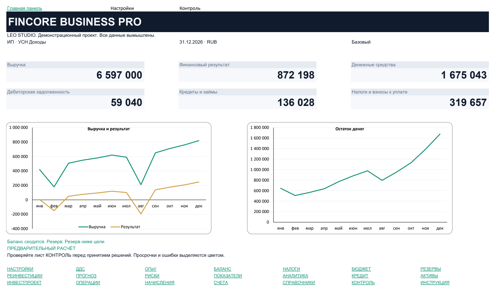

# FINCORE — Excel Financial Model

**English** | [Русский](README.ru.md)

An Excel business model for a fictional service company, by [LEO STUDIO](https://leo-studio.onrender.com/). It demonstrates connected registers, financial reports and planning views.

**Status:** portfolio demo with fictional data. The workbook interface is in Russian and amounts are in RUB. It is a management model, not statutory accounting or tax filing software.

## Features

- Cash transactions, accruals and balances across accounts.
- Cash flow, profit and loss, and a balance sheet.
- Budget, reserves, reinvestment, risk and forecast views.
- Loan schedule, fixed assets and an investment project.
- Input validation and a separate control sheet.

## Open and use

1. Download [FINCORE_DEMO.xlsx](FINCORE_DEMO.xlsx) and save a local working copy.
2. Open it in desktop Microsoft Excel. No Python, server, installation script or macros are required.
3. Review НАСТРОЙКИ (Settings), then ОПЕРАЦИИ (Cash transactions) and НАЧИСЛЕНИЯ (Accruals).
4. Change a fictional input in your working copy, recalculate in Excel and review ПАНЕЛЬ (Dashboard), ДДС (Cash flow), ОПиУ (P&L) and КОНТРОЛЬ (Control).
5. Keep the original demo for comparison. The workbook is editable, including formula cells; avoid overwriting formulas.

Example: add a fictional service document and its linked payment, then inspect how the receivable is replaced by cash. A payment should not recognize the same revenue for a second time. Consult the control sheet before trusting an output.

## Structure and documentation

The workbook contains 22 sheets organized around inputs, reports, planning, assets and controls. This repository includes one demo workbook, its dashboard capture, and Russian guides: [user guide](USER_GUIDE.ru.md), [model description](MODEL_DESCRIPTION.ru.md) and [tax assumptions](TAX_ASSUMPTIONS.ru.md). This English README gives the setup, usage and limitations.

## Verification

On 17 October 2026 the OOXML package was inspected: 22 sheets, 15,259 formula elements, no VBA project, no Excel external-link parts and no stored error-type cells. This is a structural check, not a new Excel recalculation or validation of financial results. The dashboard is an existing capture of the fictional example. [Verification details](VERIFICATION.md).

## Known limitations

One calendar year, RUB and a simplified service-company model. Inventory, multi-currency accounting, complex advances and offsets, detailed VAT documents, leasing and full accounting entries are outside scope. Tax parameters are illustrative assumptions and must be checked before any real use. No legal or tax accuracy is claimed for the current year. Behavior in LibreOffice, Excel Online and Google Sheets was not verified in this publication run. No live recalculation in desktop Excel was performed in this run.

## License

No redistribution or reuse license has been selected by the owner. No third-party executable code is bundled. Excel is a separate product and is not included.
